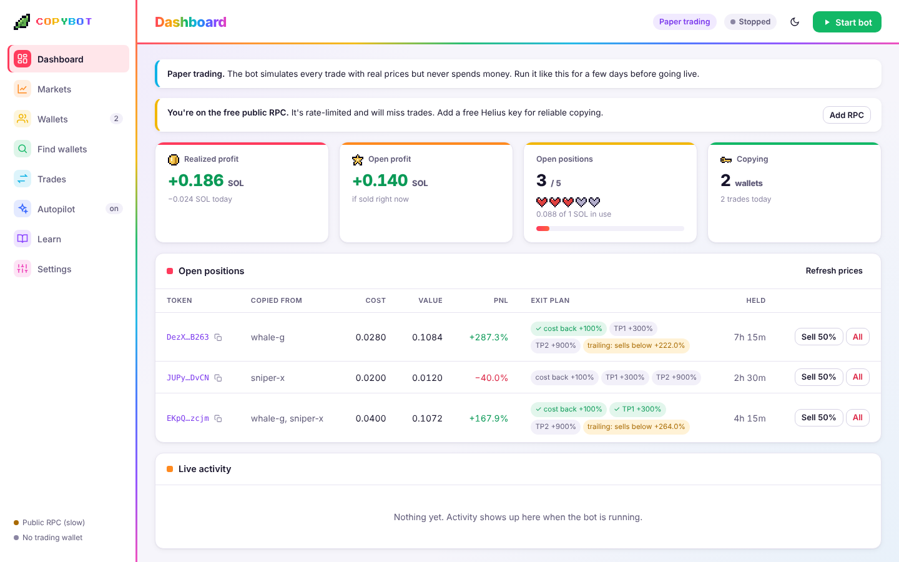
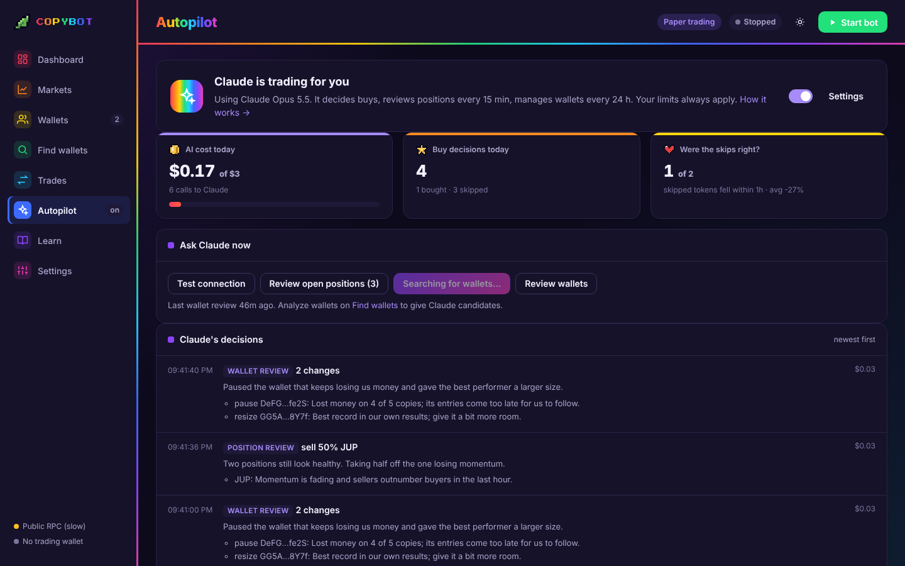
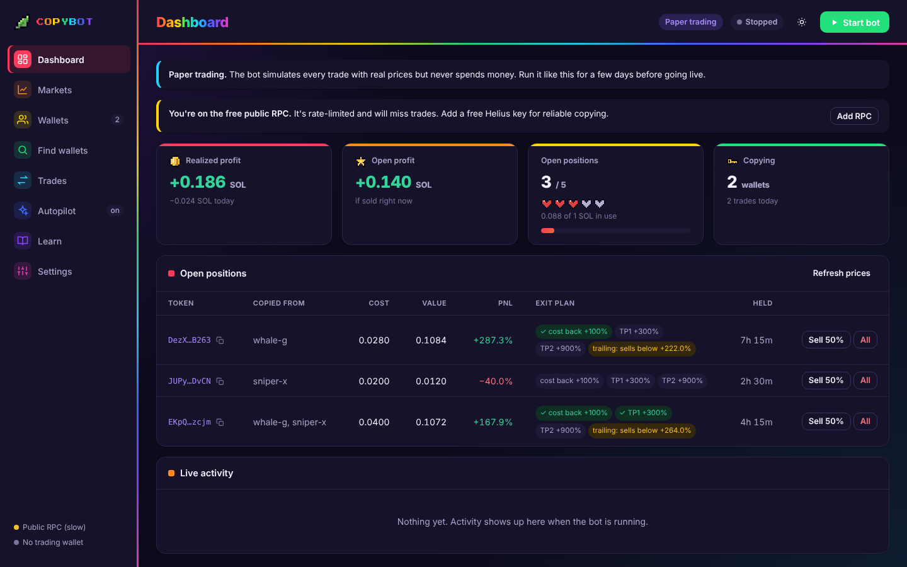

# Remora

**A Solana copy-trading bot with a desktop app.** Pick wallets to follow; when one of them buys or
sells a token, Remora can copy the trade within seconds, with safety checks, staged exits, limits
you control, and an optional AI autopilot powered by Claude.

[](https://github.com/catsandlights-ops/Remora/releases/latest)


> **It starts in paper mode:** every trade is simulated with real prices and nothing is spent.
> Run it like that for a few days before you put real money in. Nothing here is financial advice.



## Download

**Windows:** download `Remora-Setup-x.y.z.exe` from the
[latest release](https://github.com/catsandlights-ops/Remora/releases/latest) and run it.
The installer isn't code-signed, so Windows SmartScreen warns you: click **More info → Run anyway**.

After that, Remora **updates itself**: new versions download in the background, are checked
against Remora's update signature, and install when you click **Restart & update**.

Mac and Linux: build from source (see [Building it yourself](#building-it-yourself)).

## What it does

### Copy trading
- Follow **any number of wallets**, each with its own on/off switch, **size multiplier** and **SOL budget**.
- Trades go through **Jupiter**, which routes across every Solana DEX (pump.fun, PumpSwap, Raydium, Orca, Meteora…).
- **Copy their sells** proportionally: if they sell half, you sell half.
- **Wallet scoreboard:** your own profit, win rate and number of trades from each wallet you copy, with a "losing money" flag.

### Strategies
Five ready-made trading styles on the **Strategies** page: **Balanced** (the defaults), **Sniper** (early, small, fast profits, tight stops), **Whale follower** (only big buys, ride winners longer), **Momentum** (tokens already moving, profits in steps) and **Conservative** (strict filters, tight stop, cost back early). Each shows exactly which settings it changes before you switch, and never changes your SOL per buy, limits, wallets or safety checks. On the Backtest page you can run a backtest with any strategy, or **Compare strategies** to replay the same trades with all five plus your current settings, ranked (buy-size rules, minimum token age, all exits and crash protection are replayed; liquidity and holder filters and the liquidity-drain check can't be, as there's no historical record of them).

### Exits and risk
- **Staged exits:** take your cost back at 2x, take profit at +300% and +900%, and a **trailing stop** protects the rest.
- **Stop-loss**, max open positions and max SOL in trades.
- **Circuit breaker:** no new buys after a 0.3 SOL loss in a day, and a 60-minute pause after 4 losing trades in a row.
- **Don't chase:** skips a copy if the price is already more than 15% above what the copied wallet paid.
- **Rug protection:** sells everything at once if a token's liquidity drains 50% from its high, its value crashes 35% within 5 minutes, or sellers outnumber buyers 3 to 1.
- **Exits per wallet:** give any wallet its own stop-loss, take-profits and trailing stop.
- **Copy gap:** measures how much worse your fills are than the copied wallet's, per wallet, on your real trades.
- **Strategy per wallet:** give any wallet its own preset (its exits, stop-loss, minimum buy size and "don't chase"); the wallet scout suggests one for each pick from its holding time and buy size.
- **Check my wallets:** backtests each copied wallet on its own with your settings and copy gap; marks it worth keeping, losing money, or too few trades, with one-click pause.
- **Profit chart** on the Dashboard for 24h, 7 days, 30 days or all time.
- **Trial period:** new wallets start at ¼ size, then ½, then full size after profitable copies; any wallet auto-pauses after 5 losing copies in a row.

### Safety checks before every buy
- Skips tokens whose creator can **freeze** your tokens.
- **Buy-then-sell test:** if a token can't be sold back, or the round trip loses more than 12%, it's skipped. This catches most honeypots.
- **Token filters** from Dexscreener: minimum liquidity, maximum buy size versus the pool, optional market-cap range and token age.
- **Holder check** (with a [Solscan](https://solscan.io/apis) API key): skips tokens where one wallet owns more than 15% of the supply, or the 10 largest wallets more than 50%. Liquidity pools and bonding curves don't count.
- **Every live transaction is verified and simulated before signing** (see [Security](#security)).

### Finding wallets
- **Discover early buyers:** paste tokens that pumped; wallets that were early on several of them rank highest.
- **Analyze:** a wallet's real on-chain record (win rate, profit, return, trades per day, hold time), with bot and "too fast to copy" warnings.
- **Copy** good wallets in one click.
- **Find my best settings:** compares 16 stop-loss/take-profit/trailing setups on the same trades, warns when the winner may be luck, and applies the one you choose.
- **History cache:** decoded wallet transactions are saved locally, so re-analyzing or re-backtesting a wallet is fast.
- **Backtest** (any period: last 24h/3d/7d/30d or custom dates): replay up to 5 wallets' real trades with your current settings, with an adjustable copy-delay cost (you always buy higher and sell lower than they did) and fees. Shows total profit, win rate, worst dip, a profit chart, per-wallet results, skipped trades and every trade. Exits follow their sells, and your stop-loss, take-profits and trailing stop are replayed from GeckoTerminal price candles.
- **Wallet scout** (*Find wallets for me*): Remora picks tokens that pumped recently, finds their early buyers (plus DexCheck top traders), checks each wallet's real record, and **Claude picks the most suitable ones** and explains why (a rule-based ranking without Claude). It searches trending, new and top-volume tokens, finds wallets that bought early or caught a recent move, and only picks wallets whose backtest with your settings made money. With the autopilot managing wallets, it runs once a day and adds its picks, up to your maximum.

### Market scanner
- **Find traders:** while the bot runs, it keeps looking at new *and older* coins that are moving, finds traders who caught the move, backtests them with your settings, and adds the best on a trial. No Claude needed.
- **Trade coins:** buys coins that are rising on real buying (up over the last hour but not already run, more buyers than sellers, more volume than usual, not falling right now), through every limit and safety check, with its own budget, stop-loss, take-profit, trailing stop and maximum hold time. It stops itself after a losing streak. Both switches are off by default.

- **Is it working?** A live track record of every coin signal (bought or not), checked later against real prices, and a **test on the past** that replays the rules on recent history with different buying rules and exits.

### Your own orders
- **Limit orders:** buy when a coin drops to (or rises past) a price; sell part or all when it hits a target or a floor. Optional expiry.
- **DCA:** buy a fixed amount every 15 minutes to a week, a set number of times, optionally only under a price cap.
- Every buy goes through your limits and safety checks. Orders run while the bot runs; paper and live orders are kept apart.

### Faster, smarter, safer trades
- **Faster copies:** all pre-buy checks (market data, holders, token safety, rug memory, wallet balance) run in parallel, and unchanging token facts are cached.
- **Smart sizing:** bigger buys when several of your wallets buy the same coin (with a one-time top-up when a second wallet confirms), sizes by each wallet's record and copy gap, optional skip of lone small buys.
- **Market mood filter:** halves or pauses buys from signals when SOL is dropping or most trending coins are falling.
- **Rug memory:** never rebuys a coin that rugged you, nor coins from the same creator.
- **Weekly settings check:** compares your exits with 15 setups on the last 7 days and suggests a better one.
- **Live execution:** per-trade dynamic slippage, and optional private (bundle-only) Jito sends against front-running. A busy swap service is reported as busy, never as a honeypot.

### Live graphs
- Wallet value over the last hour, 6 or 24 hours (sampled every 30 seconds and kept across restarts), a trend line per open position with a click-through live chart showing its exits and your buys and sells, each order's price against its target, the scanner's results and rising coins, profit per wallet, a running total on the report, and the same on the phone. Hover for exact values.

### Panic button, reports and taxes
- **Sell everything & stop** from the Dashboard or your phone, plus an optional **panic limit** that does it automatically when today's closed and open result reaches a loss you set.
- **Profit report** by day, week or month, with best and worst trades and results per wallet.
- **Tax export:** a year of trades with USD values (daily SOL prices) and the gain or loss on each sale (average-cost method).

### Phone access
- **Control Remora from your phone** at home over Wi-Fi, or anywhere with the free [Tailscale](https://tailscale.com/download) app: profit, positions, trades and activity; start and stop; sell half or all of a position; the scanner switches.
- **Paired with a one-time QR code** (5 minutes, single use). Each phone has its own key, stored only as a hash, and can be removed at any time.
- Off by default, and **only answers your home network and Tailscale**, never the open internet. A phone can't change settings, switch to live mode, or see keys and wallets.

### Alerts, speed and reliability
- **Phone alerts** on Telegram or Discord: trades, problems, the circuit breaker and autopilot decisions, with rate limiting.
- **Backup RPC** with automatic failover and switch-back.
- **Jito tips** (live mode) so trades land sooner when the network is busy; tips can only go to Jito's official tip accounts, capped by you.
- **Fast trade detection** with Helius Enhanced WebSockets, falling back automatically when your plan doesn't include it.
- **CSV export** of your trades.
- A short **setup guide** on first launch.

### Markets hub
- SOL, BTC and ETH prices; **trending** and **new** Solana pools; token pages with **price charts**, buyers vs sellers and a filter verdict.
- **Crypto news** and a **watchlist**.
- **Whale trades** and **top traders** per token with a free [DexCheck](https://dexcheck.ai) API key.

### AI autopilot (optional, Claude Opus 5.5)



- **Buys:** for each copy signal that passed every safety check, Claude decides **buy or skip** and how big (¼× to 2×), and explains why.
- **Open positions:** reviewed every 15 minutes; Claude can sell early. Your stop-loss and take-profits still run on their own.
- **Wallets:** Claude can pause losing wallets, resize them, and add wallets found by the wallet scout or that you analyzed.
- **It can never go past your limits** or skip a safety check. After any resize, the price is re-checked before buying.
- Uses **your own Anthropic API key**; roughly $0.02–0.04 per decision, capped by a **daily AI budget** (default $3). When the budget is used up, or Claude is unavailable, Remora falls back to its normal rules.
- The Autopilot page logs every decision with its cost, and checks **what each skipped token did an hour later**, so you can see whether Claude's skips helped.

### Learn
Short built-in guides: getting started, connecting a fast RPC, finding wallets, how exits work, risk limits, the safety checks, going live, the autopilot, the Markets hub and a glossary.

### Look
One theme that mixes a clean modern layout with rainbow arcade touches, in **light and dark** mode
(or follow your computer). Switch with the sun/moon button or in Settings → Look.



## Getting started

**Fastest way to try it:** install, then press **Start bot**. In paper mode with no wallets, Remora picks 3 traders who just caught moves on different trending tokens and starts a paper experiment with a pretend 10 SOL wallet (shown on the Dashboard, with a Reset button). Nothing is ever spent. For the full setup:

1. **Install** Remora (see [Download](#download)).
2. **Add a fast RPC:** Settings → Connection → paste a free [Helius](https://www.helius.dev) link, then **Test connection**. The free public RPC is rate-limited and misses trades.
3. **Find wallets** on the Find wallets page (or Markets → top traders) and **Analyze** them before copying.
4. **Add 2–3 wallets** and press **Start bot**. You're in paper mode.
5. **Review after a few days.** The Wallets scoreboard shows which wallets actually made *you* money.
6. **Going live** (only after paper mode has been profitable): use a **brand-new wallet** with only what you can afford to lose, paste its key in Settings → Trading wallet, then switch Settings → Trading mode to **Live**.

Optional keys (Settings → Connection or the Autopilot page): **DexCheck** for whale trades and top
traders, **Anthropic** for the AI autopilot, **Solscan** for the holder check, **Jupiter** if you outgrow its free tier. Your wallet key and the DexCheck, Anthropic and Solscan keys are
stored encrypted by Windows on your computer.

## Where your data lives

Settings, keys, positions and trade history stay on your computer, in your user folder
(menu **File → Open Data Folder**):

- Windows: `%APPDATA%\Remora` (installs from before the rename keep using `%APPDATA%\Copybot`)
- Mac: `~/Library/Application Support/Remora` (or `…/Copybot` for older installs)

Uninstalling the app doesn't delete this folder. Paper and live positions are kept separately.

## Security

How Remora protects your wallet:

- **Every swap is verified before signing.** Jupiter builds each swap, and Remora checks it first (`src/txguard.ts`). It may only use the expected programs (Jupiter, Token, Token-2022, Associated Token Account, Compute Budget), must not send SOL or tokens anywhere except your own accounts, and its priority fee must stay within your limit. It's then **simulated** against the live chain to confirm your balance drops by no more than the trade plus fees. Anything else is refused and logged, so a compromised API can't drain the wallet.
- **Quotes are checked:** only used if they match exactly the token, amount and slippage requested.
- **Keys are encrypted at rest.** Your trading wallet key and the Anthropic, DexCheck and Solscan API keys are encrypted with Windows DPAPI: only your Windows account on this computer can read them. The key is never shown in the app, logged or sent anywhere.
- **The control panel is locked to the app.** It only listens on `127.0.0.1`, every request needs a random per-session token, and foreign `Host` headers are refused (blocks DNS-rebinding attacks).
- **Hardened window.** Strict Content-Security-Policy, sandboxed Electron window with no Node access, all device permissions refused, all on-chain text escaped, and links open only to a short list of known sites.
- **AI guardrails.** Token names are stripped before they reach Claude, everything Claude returns is validated and clamped to your limits, and Claude can only add wallets whose record was analyzed.
- **Signed updates.** Every update must carry a valid Ed25519 signature from the Remora release key; the app holds only the public key (`electron/update-public-key.pem`) and refuses anything else, even if GitHub or the download were compromised.
- **Settings have hard limits** (slippage up to 50%, priority fee up to 0.05 SOL per trade, and so on), so a typo can't wreck your balance.

What you still need to do: use a **separate wallet** with a small balance, keep Windows updated,
and only download Remora from this repository's releases.

## Risks, honestly

- You always buy **after** the wallet you copy, so at a worse price. On small meme coins that gap can erase the edge.
- Some public "smart wallets" profit from the people copying them.
- Safety checks reduce scam losses but can't catch everything. No AI can reliably predict meme coins.
- Never run it with money you can't afford to lose.

---

## For developers

### Building it yourself

```bash
npm install
npm run desktop      # run the desktop app without installing
npm run dist:win     # → release/Remora-Setup-x.y.z.exe  (Windows, or Linux with Wine)
npm run dist:mac     # → release/*.dmg                     (on a Mac; unsigned: right-click → Open the first time)
npm run dist:linux   # → release/*.AppImage
npm test             # unit tests
npm run test:fuzz    # junk sent to every app endpoint: nothing may error out or crash
npm run test:stress  # 3 minutes of trading in a made-up market (Solana + Base), crashed at random,
                     #   with the books checked every 30 s (longer: node scripts/stress/run.mjs 20)
npm run test:ui      # opens every page in a headless browser, walks the go-live assistant
npm run test:phone   # pairs a simulated iPhone, opens every tab of the phone page, pauses a wallet
npm run test:resume  # kills the app while running: the bot must come back; after you stop it, it must not
```

The end-to-end checks (`scripts/stress/`) run the real app against a made-up market (`world.mjs`):
moving prices, pumps, dumps and rugs, fake traders on both chains, and answers in the exact formats
of a Solana node, a Base node, Jupiter, KyberSwap, GoPlus and Dexscreener, with "too many requests",
slow and broken replies mixed in. Nothing touches the internet or real money.

### Browser version and headless mode

- `npm run app` starts the same app in your browser at http://localhost:4777 (or double-click
  `Start Remora (Windows).bat` / `Start Remora (Mac).command`). Keep the terminal window open.
- `npm start` runs the bot in the terminal using `config.json`, handy on a VPS. To use the UI on a VPS,
  keep it private and tunnel: `ssh -L 4777:localhost:4777 you@your-vps`.

On a VPS (about $5/month at DigitalOcean, Vultr or Hetzner; pick US East or Frankfurt/Amsterdam):

```bash
git clone https://github.com/catsandlights-ops/Remora.git && cd Remora && npm install
npm install -g pm2
pm2 start "npm start" --name remora   # or "npm run app" for the UI
pm2 save && pm2 startup                # restart after reboots
```

### Command-line tools

```bash
cp .env.example .env && cp config.example.json config.json
npm run discover -- <mint1> <mint2> <mint3>     # wallets that bought these tokens early
npm run analyze -- <wallet1> <wallet2> --txs 500 # their real win rate, profit, ROI, hold time
```

Good copy targets have positive profit over **many** closed trades, fewer than ~100 trades a day,
and hold for minutes or hours, not seconds.

### Configuration (`config.json`)

Everything is editable in the app's Settings page; the file is the same thing on disk.

| Setting | What it does |
|---|---|
| `mode` | `"paper"` (simulated) or `"live"` (real money) |
| `wallets[]` | `address`, `label`, `enabled`, `sizeMultiplier`, `maxExposureSol` (0 = no budget), optional `exits` overrides |
| `buy.sizing` | `"fixed"` = `fixedSol` every time; `"percent"` = `percentOfTarget`% of what they spent |
| `buy.minSol` / `maxSol` / `minTargetBuySol` | size limits, and ignore their small test buys |
| `sell.copySells` | sell the same share of your bag when they sell |
| `risk.stopLossPct` / `takeProfitPct` | stop-loss, and optional sell-everything level (0 = off) |
| `risk.maxOpenPositions` / `maxTotalExposureSol` / `solReserve` | position and balance limits |
| `risk.maxPriceDriftPct` | don't chase: skip if our price is this % above their entry |
| `risk.dailyLossLimitSol` / `pauseAfterLosses` / `pauseMinutes` | circuit breaker |
| `risk.maxSignalAgeSec` | don't copy trades older than this |
| `exits.*` | `recoverCostAtPct`, `tp1AtPct`/`tp1SellPct`, `tp2AtPct`/`tp2SellPct`, `trailingAfterPct`/`trailingStopPct` |
| `filters.*` | `minLiquidityUsd`, `maxTradePctOfLiquidity`, `minMarketCapUsd`, `maxMarketCapUsd`, `minTokenAgeMin`, `skipIfNoMarketData`, `maxTopHolderPct`, `maxTop10HoldersPct` |
| `safety.*` | `slippageBps`, `maxRoundTripLossPct`, `rejectFreezeAuthority`, `rejectMintAuthority`, `rejectToken2022`, `blacklist` |
| `execution.*` | `priorityLevel`, `priorityFeeMaxLamports`, `jitoTipLamports` (0 = off), `fastStream` |
| `protect.*` | `liquidityDropPct`, `crashPct`, `crashWindowMin`, `maxSellBuyRatio` (rug protection) |
| `alerts.*` | `trades`, `errors`, `guard`, `autopilot` (which events go to Telegram/Discord) |
| `trial.*` | `enabled`, `winsToStepUp`, `pauseAfterLosses` (new-wallet trial and auto-pause) |
| `ai.*` | `enabled`, `decideBuys`, `reviewPositions`, `reviewEveryMin`, `manageWallets`, `walletReviewHours`, `maxWallets`, `scoutEveryHours`, `scoutMaxPicks`, `dailyBudgetUsd`, `guidance` |

Set a number to 0 to turn that rule off.

### How it works

1. **Watch:** subscribes to each wallet over WebSocket, with polling as a backup.
2. **Decode** (`src/decode.ts`): compares the wallet's SOL and token balances before and after each transaction, so it understands swaps on any DEX without per-DEX code.
3. **Filter** (`src/rules.ts`, `src/safety.ts`): circuit breaker, limits and budgets, market filters, freeze and round-trip checks, don't-chase.
4. **Decide** (`src/ai.ts`, optional): Claude buy/skip and sizing, then a fresh quote and re-check.
5. **Execute** (`src/trader.ts`, `src/txguard.ts`): Jupiter quote and swap, verified and simulated, then confirmed; in live mode the real filled amounts are read back from the chain.
6. **Manage** (`src/engine.ts`): copied sells, staged exits, trailing stop, stop-loss and AI position reviews.

The control panel's server is split by feature: `src/server.ts` (the routes and startup),
`server-core.ts` (the engine, live updates, background jobs, HTTP helpers), `server-scout.ts`
(finding wallets), `server-scanner.ts` (the market scanner), `server-learning.ts` (backtests,
learning, shadow promotion, the weekly settings check), `server-golive.ts` (Ready for live? and the
go-live assistant), `server-status.ts` (connection status, portfolio value) and `server-phone.ts`
(phone access).

### Publishing an update

1. Commit the change, then bump the version and push to `main`:
   ```bash
   npm version minor --no-git-tag-version   # e.g. 0.5.0 → 0.6.0
   git commit -am "Release 0.6.0" && git push
   ```
2. GitHub Actions (`.github/workflows/release.yml`) builds the Windows installer, signs it with the
   `UPDATE_SIGNING_KEY` repository secret and publishes the release. Installed apps pick it up within
   4 hours, or right away with **Check for updates**.

Optional: code-sign the installer so Windows SmartScreen stops warning, see [docs/CODE-SIGNING.md](docs/CODE-SIGNING.md).
Releases also run the type-check and tests first, and are not published if any fail.

Keep a backup of the update signing key (`signing/update-signing-key.pem`, never committed). Without
it, existing installs can't accept updates; if it leaks, rotate it and ship a manual reinstall.
